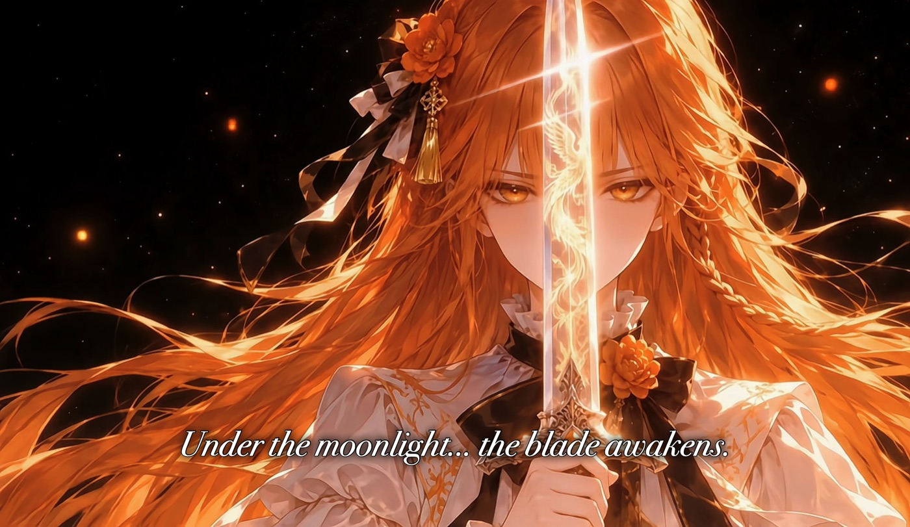

# AI Boot Animations · AI 应用开机动画

给 Mac 上的 AI 桌面应用加开机动画：打开应用时先放一段开屏，再透出真正的界面，留下一层半透明的动态背景。每个动画都是独立的小程序，**不修改应用本体**，随时一键卸载。

| 应用 | 动画 | 安装 |
|---|---|---|
| **Claude** 桌面端 | 月下持剑少女：线稿 → 上色 → 剑光、火凤、烟花，带音效和英文字幕；菜单栏 ✨ 可调背景浓度、音量，可只留动态背景 | [claude/](claude/) |

更多动画陆续加入。



## 快速安装（以 Claude 为例）

需要 macOS 13 或更新，以及 Xcode 命令行工具（没有的话先运行 `xcode-select --install`）。

```bash
git clone https://github.com/celestewynne0506-pixel/ai-boot-animations.git
cd ai-boot-animations/claude
./install.sh
```

详细说明、设置和卸载见各文件夹里的 README。

## 授权

- 代码：[MIT](LICENSE)
- 动画素材：各文件夹 `assets/LICENSE.md` 单独说明（Claude 动画为 CC BY-NC-ND 4.0：可安装分享，不可商用、不可改后再发布）

> 非官方同人项目，与各 AI 应用的开发公司无关。Claude 是 Anthropic 的商标。

---

**English:** Boot animations for AI desktop apps on macOS. Each one is a small menu-bar helper that overlays the app's window with an intro, then fades into a translucent, click-through looping background, without modifying the app itself. See each folder for install instructions.
